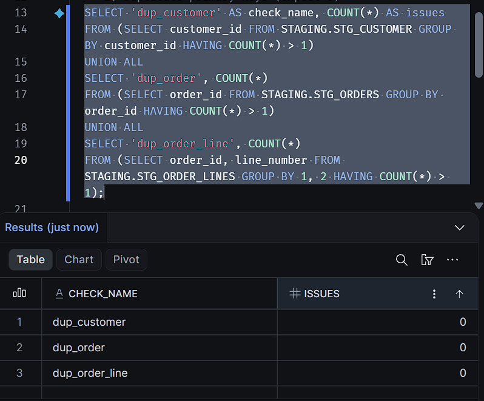
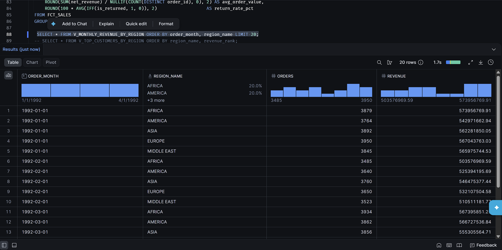
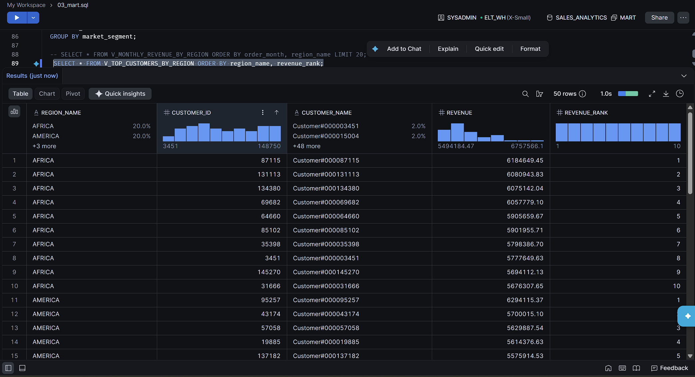
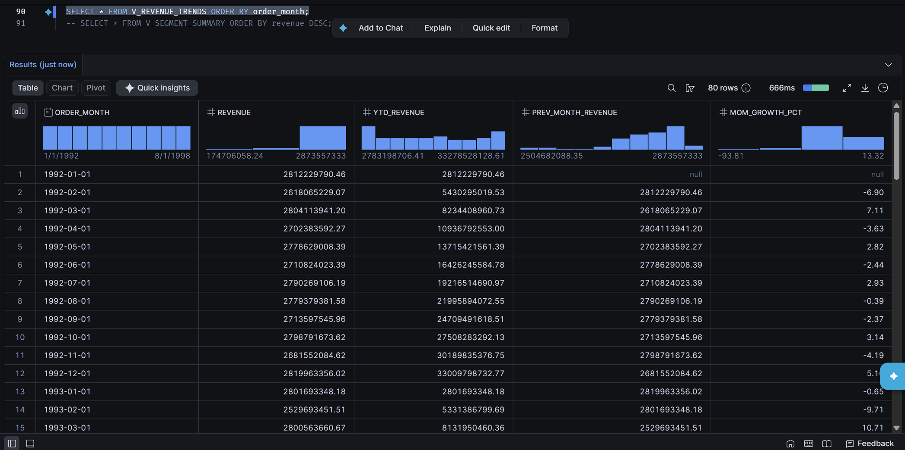
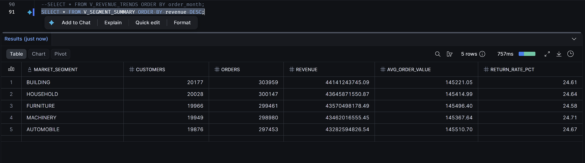
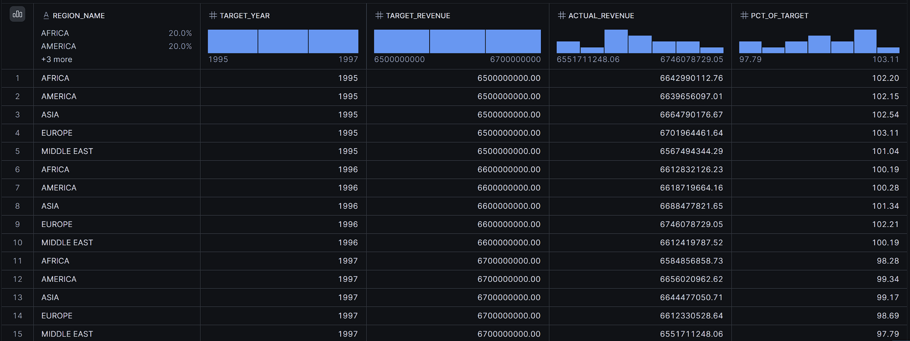

# Snowflake Sales Analytics ELT Pipeline

A layered ELT pipeline in Snowflake built on the TPC-H sample dataset (~6M order lines, 1992–1998).
Source data is loaded as-is, then cleaned and modeled into business-ready analytical views with SQL.
An external CSV with revenue targets is ingested through an internal stage with `COPY INTO`.

## Architecture

```
SNOWFLAKE_SAMPLE_DATA.TPCH_SF1          data/regional_targets.csv
        │  (Extract + Load)                     │  (stage + COPY INTO)
        ▼                                       ▼
RAW        – source copy + _LOADED_AT timestamp, REGIONAL_TARGETS
        │  (Transform: clean, rename, cast, decode, dedupe)
        ▼
STAGING    – STG_CUSTOMER, STG_ORDERS, STG_ORDER_LINES, STG_GEOGRAPHY
        │  (Transform: join + aggregate)
        ▼
MART       – FCT_SALES + analytical views
```

## Analytical views

| View | What it answers | SQL used |
|---|---|---|
| `V_MONTHLY_REVENUE_BY_REGION` | Revenue and orders per month per region | GROUP BY, DATE_TRUNC |
| `V_TOP_CUSTOMERS_BY_REGION` | Top 10 customers in each region | CTE, RANK(), QUALIFY |
| `V_REVENUE_TRENDS` | Year-to-date revenue and month-over-month growth | SUM() OVER, LAG() |
| `V_SEGMENT_SUMMARY` | Revenue, average order value and return rate per segment | aggregates, IFF |
| `V_TARGET_VS_ACTUAL` | Actual revenue vs targets loaded from CSV | stage, COPY INTO, LEFT JOIN |

## Data quality checks

`04_quality_checks.sql` validates row counts across layers, duplicate keys, orphan records
and revenue reconciliation between STAGING and MART.

## Results

**Data quality – no duplicate keys in STAGING**


**Monthly revenue by region**


**Top 10 customers per region (RANK)**


**Revenue trends – YTD running total and month-over-month growth (SUM OVER, LAG)**


**Segment KPIs – revenue, average order value, return rate**


**Target vs actual – CSV loaded via stage + COPY INTO**


## Key findings

- Revenue is evenly spread across the 5 market segments (~43–44B each), with a return rate of ~24.6% in every segment.
- Monthly revenue is stable at ~2.6–2.8B; the last month (1998-08) is partial in the source data, which explains the sharp final drop in MoM growth.
- All regions exceeded their 1995 and 1996 targets (100–103%) and fell slightly short in 1997 (97.8–99.3%).

## How to run

Run the scripts in a Snowflake worksheet, in order:

1. `sql/00_setup.sql` – warehouse, database, schemas
2. `sql/01_raw.sql` – load source tables
3. `sql/02_staging.sql` – clean and type data
4. `sql/03_mart.sql` – fact view and analytical views
5. `sql/04_quality_checks.sql` – validation
6. `sql/05_optional_csv_load.sql` – create stage, upload `data/regional_targets.csv`, load with COPY INTO

## Tech

Snowflake · SQL (CTEs, window functions) · ELT · layered data modeling · data quality checks
